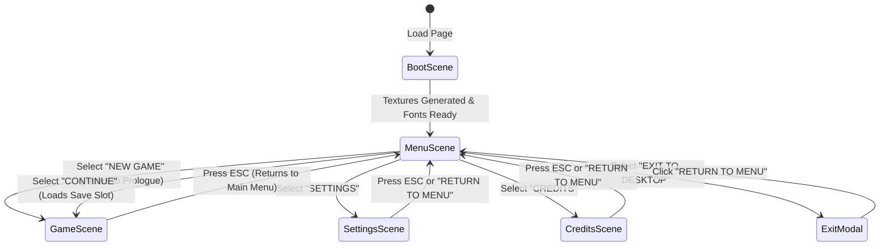

# THE HOLLOW HOUR — Architecture Documentation

This document describes the codebase architecture, design patterns, rendering pipeline, and system relationships for **THE HOLLOW HOUR**.

---

## Technical Stack & Configuration

- **Game Engine**: Phaser 3 (WebGL primary with Canvas fallback).
- **Language**: TypeScript 5.5+ (Strict mode, ES2022).
- **Bundler & Dev Server**: Vite 5.
- **Physics**: Phaser Arcade Physics (`gravity: { x: 0, y: 0 }` for top-down 2D exploration).
- **Unit Testing**: Vitest 2 with Happy-DOM environment.
- **E2E & Browser Automation**: Puppeteer-Core with Chromium/Brave headless.
- **Display Resolution**:
  - Virtual Native Resolution: **640 x 360** (16:9).
  - Scale Mode: `Phaser.Scale.FIT`, auto-centered both vertically and horizontally.
  - Pixel Precision: `pixelArt: true`, `roundPixels: true` (nearest-neighbor sampling, no texture blurring).

---

## Directory Structure

```
game-jam/
├── public/                 # Static web assets & fonts
├── scripts/                # Headless browser test scripts (puppeteer)
│   ├── test_menu.js
│   ├── test_mouse.js
│   └── test_all_scenes.js
├── src/
│   ├── __tests__/          # Vitest unit test suites
│   │   ├── setup.ts
│   │   ├── GameConfig.test.ts
│   │   └── SaveManager.test.ts
│   ├── audio/              # Audio systems
│   │   └── AudioManager.ts # Web Audio procedural horror drone & SFX
│   ├── data/               # Persistent data models
│   │   └── SaveManager.ts  # Save game slot read/write/delete
│   ├── scenes/             # Phaser Scene hierarchy
│   │   ├── BootScene.ts    # Texture synthesis & asset initialization
│   │   ├── MenuScene.ts    # Main menu, background parallax, lighting & options
│   │   ├── SettingsScene.ts# Audio sliders, CRT toggle, fullscreen
│   │   ├── CreditsScene.ts # Attribution & inspirations
│   │   └── GameScene.ts    # Prologue transition / gameplay foundation
│   ├── ui/                 # Reusable UI components
│   │   └── MenuButton.ts   # Interactive gothic menu option
│   ├── utils/              # Utility generators
│   │   └── PixelArtGenerator.ts # Procedural 16-bit gothic pixel-art textures
│   ├── config.ts           # Global Phaser.GameConfig
│   ├── main.ts             # Application entrypoint & audio unlock
│   └── types.ts            # Shared interfaces & data types
├── ARCHITECTURE.md         # System relationships & architectural guidelines
├── ASSET_MANIFEST.md       # Asset registry and palette definitions
├── DEVELOPMENT_ROADMAP.md  # Phase-by-phase development tracker
├── PROGRESS.md             # Development log and test verification records
├── project_context.md      # Game vision, story, and horror aesthetics
└── project_implementation.md # Phase execution plan
```

---

## Scene Flow & Lifecycle



---

## Subsystems

### 1. `AudioManager` (`src/audio/AudioManager.ts`)
- Implemented as a Singleton.
- Uses Web Audio API procedural synthesis:
  - Atmospheric dark horror drone: Dual sub-oscillators (36.7Hz D1 and 55Hz A1), tritone tension oscillator (103.8Hz G#2), slow LFO low-pass sweep, and filtered white-noise wind layer.
  - UI sound effects:
    - `playHover()`: Hollow wooden tick with subtle metallic transient.
    - `playSelect()`: Ominous low iron gong.
    - `playBack()`: Soft muffled wooden tick.
    - `playDisabled()`: Heavy muted dull thud.
    - `playThunder()`: Low sub rumble with band-pass noise sweep.
- Connects to `localStorage` under `the_hollow_hour_settings`.
- Safe autoplay unlock on first user gesture (`pointerdown`, `keydown`, `touchstart`).

### 2. `SaveManager` (`src/data/SaveManager.ts`)
- Manages save data slots in `localStorage` under `the_hollow_hour_save_slot_1`.
- Provides `hasSave()`, `getSave()`, `createSave()`, `deleteSave()`.
- Synchronizes with `MenuScene` to enable/disable the `CONTINUE` button dynamically.

### 3. `PixelArtGenerator` (`src/utils/PixelArtGenerator.ts`)
- Generates procedural 16-bit gothic textures adhering strictly to the *Lamentum* color palette:
  - `mansion_sky`: Dark night gradient with craters on pale moon, mountain ridge, and clouds.
  - `mansion_building`: Gothic Victorian architecture with gable roof, mansard roof, clock tower, chimneys, and mullioned windows.
  - `mansion_foreground`: Wet cobblestone pathway, wrought iron spear-head fence, gate pillars with lanterns, dead gnarled trees, and gravestones.
  - `fog_layer_1`, `fog_layer_2`: Parallax looping cloud textures.
  - `candle_anim`: 4-frame sprite sheet with animated flickering flames and tallow drips.
  - `ui_cursor`: Pixel-art gothic dagger.
  - `ui_plaque`: Dark slate menu plaque with blood-red border and brass rivets.
  - `ui_frame`: Ornate corner flourishes.
  - `ui_slider_track` & `ui_slider_thumb`: Gothic brass/ruby sliders.

---

## Architectural Principles for Future Phases

1. **Top-Down 2D Exploration**: Player entity will use Phaser Arcade Physics with circular/rectangular body collisions aligned to character feet.
2. **Data-Driven Systems**: Dialogue trees, evidence records, and room definitions will be decoupled from rendering code as JSON/TypeScript data structures.
3. **State Machine Entity AI**: The werewolf AI in Phase 7 will be built as an explicit finite-state machine (`PatrolState`, `InvestigateState`, `ChaseState`, `AttackState`).
4. **Light & Shadow System**: Dynamic dark overlays with blend modes (`MULTIPLY` or render textures) for flashlight and candle lighting cones.
